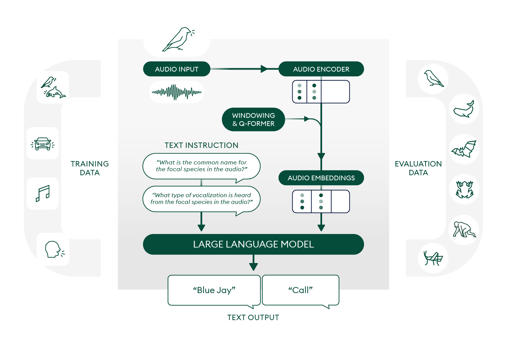

# NatureLM-audio

  <a href="https://openreview.net/forum?id=hJVdwBpWjt" target="_blank" class="resource-link">
     Paper
  </a>
  ·
  <a href="https://github.com/earthspecies/NatureLM-audio" target="_blank" rel="noopener" class="resource-link">
     Code
  </a>
  ·
  <a href="https://huggingface.co/EarthSpeciesProject/NatureLM-audio" target="_blank" class="resource-link">
     Model
  </a>
  ·
  <a href="https://huggingface.co/datasets/EarthSpeciesProject/BEANS-Zero" target="_blank" class="resource-link">
     BEANS-Zero
  </a>

## Updates

  2026-04-09
  Our <a href="https://huggingface.co/spaces/EarthSpeciesProject/NatureLM-Audio" target="_blank">Interactive Demo</a> has been updated to NatureLM-audio v1.1. See the <a href="quick_start.html">Quick Start Guide</a> and <a href="prompting_guide.html">Prompting Guide</a> to learn what's supported.

  2025-05-27
  We've updated NatureLM-audio with a flexible merge between the original Llama 3.1 8B and the LoRA fine-tuned weights. Merging with the original weights improves prompt flexibility but comes at the cost of some bioacoustic task performance. See the <a href="usage.html#model-merging">Usage</a> page and <a href="https://arxiv.org/abs/2511.05171" target="_blank">paper</a> for details.

## Overview

NatureLM-audio is the first audio-language foundation model designed specifically for bioacoustics. It combines a fine-tuned audio encoder ([BEATs](https://github.com/microsoft/unilm/tree/master/beats)) with a large language model ([Llama 3.1 8B Instruct](https://huggingface.co/meta-llama/Meta-Llama-3.1-8B-Instruct)), enabling researchers to query bioacoustics data using natural language.

Key capabilities:

- **Flexible task support:** species classification, detection, call type and life stage classification, audio captioning, and individual counting
- **Zero-shot generalization:** trained across bioacoustics, speech, and music, the model transfers acoustic knowledge to unseen species and taxa
- **Real-world scale:** designed for large, diverse, and sparsely labeled datasets typical of conservation fieldwork
- **Accessible by design:** no task-specific fine-tuning required; researchers can interact with the model with plain English natural language prompts
